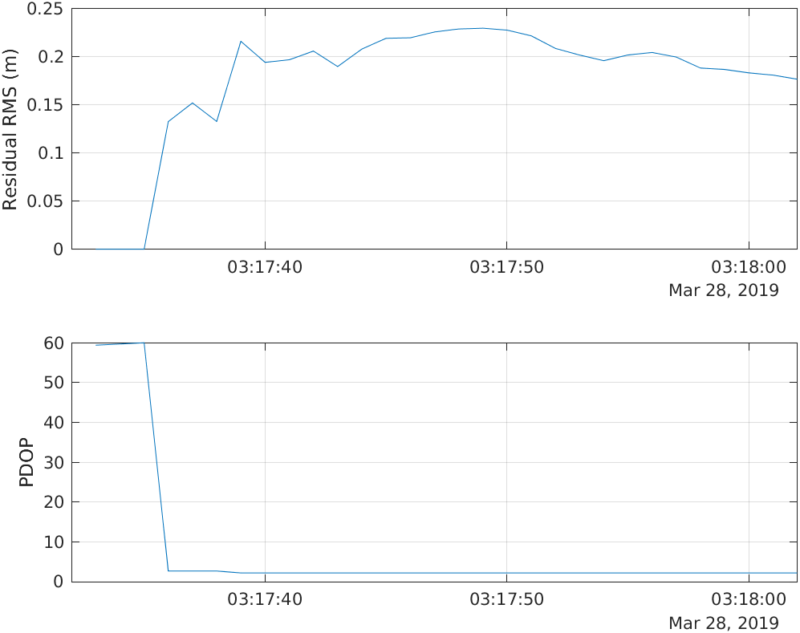
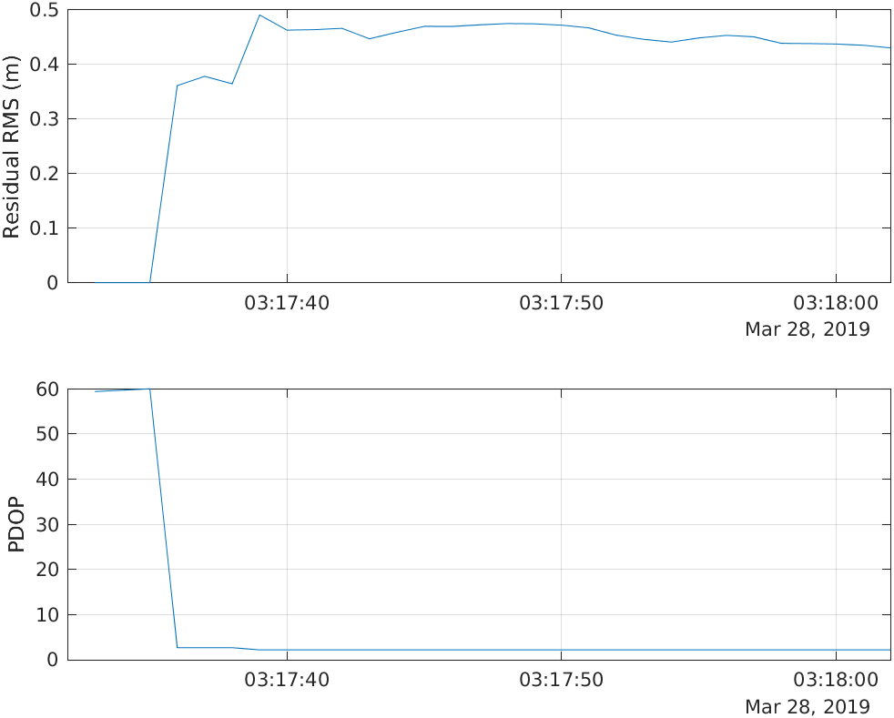

# 实测样例与验证记录

验证环境：MATLAB R2024b，GitHub Actions Linux runner。数据：仓库随附的 2019-03-28 观测、广播星历与 SP3 文件。

**14 项回归测试全部通过**。广播星历与 SP3 模式各处理前 30 个历元。

[查看对应工作流](https://github.com/2809728882/MATLAB-GNSS-SPP/actions/runs/38032451292)

验证代码提交：`d13a5760f726a0ae22b95a334255d3a6aa5ae5aa`。

| 模式 | 输入历元 | 成功历元 | 残差 RMS 中位数 米 | PDOP 中位数 |
| --- | ---: | ---: | ---: | ---: |
| 广播星历 | 30 | 30 | 0.198 | 2.220 |
| SP3 | 30 | 30 | 0.449 | 2.220 |

残差 RMS 反映伪距模型拟合，不代表坐标定位精度。最初仅有四颗有效卫星的历元没有多余观测，残差接近零，但 PDOP 接近 60；这也是质量指标需要一起查看的原因。文件头近似坐标不是独立真值，此处不据此宣称绝对定位精度。

## 广播星历模式



[CSV 结果](sample-results/broadcast/positions.csv) · [运行摘要](sample-results/broadcast/summary.json)

## SP3 模式



[CSV 结果](sample-results/sp3/positions.csv) · [运行摘要](sample-results/sp3/summary.json)

## 复现

```matlab
addpath('code');
runSPP(struct('maxEpochs',30,'outputDir','outputs/broadcast'));
runSPP(struct('maxEpochs',30,'ephemerisMode','sp3','outputDir','outputs/sp3'));
```

[JUnit 回归测试报告](sample-results/test-results.xml)
